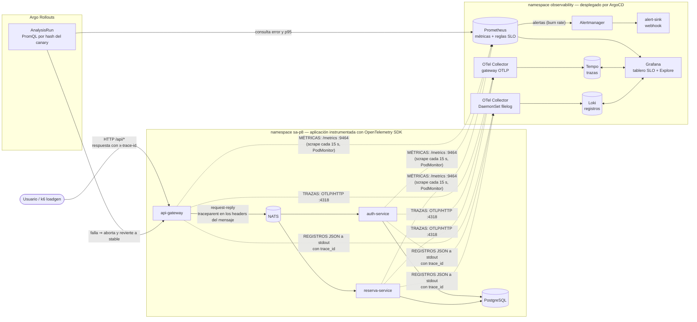

# Flujo de telemetría

## Cómo se correlacionan las tres señales

- **Traza ↔ registro:** cada línea de log JSON lleva `trace_id` y `span_id`
  del span activo. En Grafana, el datasource de Loki convierte `trace_id` en
  un enlace a Tempo (*campo derivado*) y el de Tempo abre en Loki los
  registros con ese `trace_id` (*traces to logs*).
- **Contexto a través de NATS:** NATS no es HTTP, así que OpenTelemetry no
  propaga el contexto solo. El gateway ya viaja los headers HTTP dentro del
  mensaje; ahí inyecta el header W3C `traceparent` y el *bridge* de cada
  microservicio lo extrae y continúa la **misma traza**. El gateway devuelve
  el `trace_id` al cliente en la cabecera `x-trace-id`.
- **Métrica ↔ versión:** Prometheus etiqueta cada serie con
  `rollouts_pod_template_hash` (el ReplicaSet de Argo Rollouts), lo que
  permite medir sólo los pods del canary.
