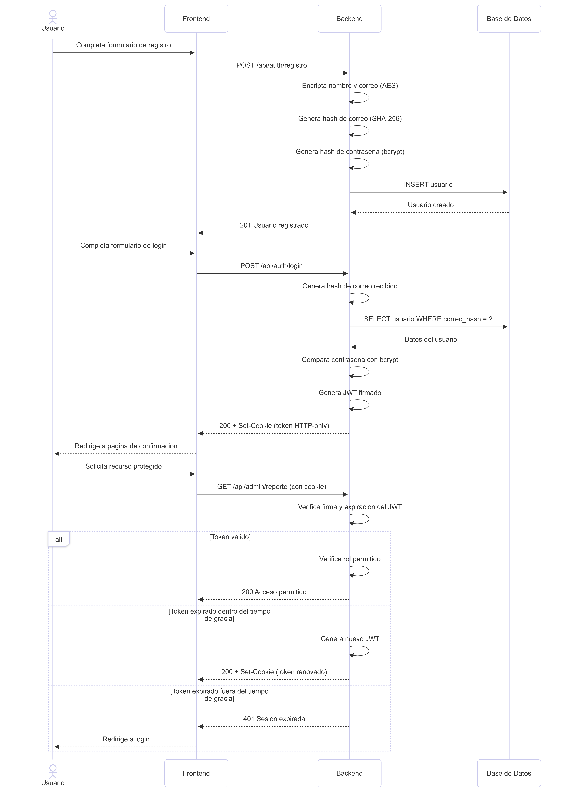

# Práctica 2: Autenticación y Autorización

Universidad San Carlos de Guatemala - Facultad de Ingeniería Software Avanzado, Sección B - Segundo Semestre 2026 Estudiante: Oswaldo Antonio Choc - Carnet 201901844

## Descripción del proyecto

Módulo de registro, login y autorización por roles (Admin / Cliente) para una aplicación full-stack. La autenticación se implementa mediante JWT almacenado en una cookie HTTP-only, con renovación automática dentro de una ventana de gracia configurable. Los datos sensibles del usuario (nombre y correo) se almacenan encriptados con AES-256, y las contraseñas se protegen con bcrypt.

Nota sobre el alcance: el enunciado original del PDF menciona un servicio de autorización independiente (microservicio desacoplado con reintentos y backoff). Este requisito fue cancelado de forma verbal por el auxiliar durante la clase del 06/08/2026, indicando que autenticación y autorización deben implementarse dentro de un mismo servicio. Por esa razón, este proyecto no incluye un microservicio separado para la autorización.

## Tecnologías utilizadas

| Tecnología                         | Uso en el proyecto                 | Ventajas                                                                                                                                                 | Desventajas                                                                                                                                                                                                                |
| ------------------------------------- | ------------------------------------ | ---------------------------------------------------------------------------------------------------------------------------------------------------------- | ---------------------------------------------------------------------------------------------------------------------------------------------------------------------------------------------------------------------------- |
| Node.js + TypeScript                | Backend y tipado estático         | Tipado reduce errores en tiempo de compilación; mismo lenguaje que el frontend; ecosistema amplio de librerías                                         | Requiere paso de compilación (`tsc`); curva de aprendizaje mayor que JS puro para quien no conoce tipos                                                                                                               |
| Express                             | Framework HTTP                     | Ligero, minimalista, gran cantidad de documentación y middlewares disponibles                                                                           | No impone una estructura de proyecto por sí mismo; hay que definirla manualmente (se resolvió con arquitectura en capas)                                                                                                 |
| PostgreSQL                          | Base de datos relacional           | Robusto, soporta restricciones a nivel de columna (como el`CHECK`en`rol`), buen soporte para producción                                         | Requiere levantar un motor de base de datos aparte (vía Docker), más pesado que una base de datos embebida como SQLite                                                                                                   |
| jsonwebtoken                        | Generación y verificación de JWT | Estándar ampliamente adoptado para autenticación sin estado (stateless); permite verificar la validez sin consultar la base de datos en cada petición | Un JWT no puede invalidarse manualmente antes de su expiración sin mecanismos adicionales (como listas negras), lo cual no se implementó en este proyecto por no ser parte del alcance                                   |
| cookie-parser                       | Lectura de cookies HTTP-only       | Permite mantener el token completamente inaccesible desde JavaScript del lado del cliente                                                                | Depende de que el navegador soporte y respete cookies correctamente configuradas                                                                                                                                           |
| bcrypt                              | Hash de contraseñas               | Algoritmo diseñado específicamente para contraseñas, con costo computacional ajustable para dificultar ataques de fuerza bruta                        | Más lento que un hash genérico (SHA-256) de forma intencional, lo cual es una ventaja de seguridad pero implica más consumo de CPU por operación                                                                       |
| AES-256 (módulo`crypto`nativo) | Encriptación de nombre y correo   | No requiere dependencias externas; encriptación simétrica robusta y estándar de la industria                                                          | Requiere manejar manualmente el vector de inicialización (IV) y la clave secreta; al usar IV aleatorio, no permite búsquedas directas sobre el campo encriptado (se resolvió con una columna de hash SHA-256 adicional) |
| Docker / Docker Compose             | Contenedor de PostgreSQL           | Aísla la base de datos del sistema operativo anfitrión; fácil de levantar, destruir y reproducir en cualquier máquina                                | Requiere tener Docker Desktop instalado y corriendo; consumo adicional de recursos del sistema                                                                                                                             |
| HTML / CSS / JavaScript (vanilla)   | Frontend                           | Sin dependencias ni proceso de build; se sirve directamente como archivos estáticos desde el mismo backend, evitando configurar CORS                    | Sin un framework, el código de manipulación del DOM es más manual; no escala bien para interfaces grandes o complejas (no es un problema para el alcance de esta práctica)                                             |

## Conceptos de seguridad aplicados

### JWT (JSON Web Token)

Es un estándar para representar información de forma compacta y verificable mediante una firma digital. En este proyecto, tras un login exitoso, se genera un JWT que contiene el `id` y el `rol` del usuario. El servidor puede verificar la validez del token en cada petición sin necesidad de consultar la base de datos, ya que la firma garantiza que el contenido no fue alterado.

El token tiene un tiempo de vida corto (configurable por variable de entorno, actualmente 60 segundos) y un tiempo de gracia adicional (también 60 segundos) durante el cual, si el token ya expiró, el servidor lo renueva automáticamente sin requerir que el usuario vuelva a iniciar sesión. Pasado ese tiempo de gracia, el usuario debe autenticarse de nuevo.

### Cookies HTTP-only

El JWT nunca se expone en el cuerpo de las respuestas ni se guarda en `localStorage` o `sessionStorage`. En su lugar, viaja dentro de una cookie configurada con el atributo `httpOnly`, lo cual impide que JavaScript del lado del cliente pueda leerla mediante `document.cookie`. Esto reduce significativamente el riesgo de robo del token mediante ataques de tipo Cross-Site Scripting (XSS).

### Encriptación AES

El nombre y el correo del usuario se almacenan encriptados con AES-256 en modo CBC. Cada vez que se encripta un valor, se genera un vector de inicialización (IV) aleatorio de 16 bytes, lo que hace que el mismo texto produzca un resultado cifrado distinto cada vez. Esto es una buena práctica de seguridad, pero impide hacer búsquedas directas sobre el campo encriptado (por ejemplo, `WHERE correo = 'x'` no funcionaría). Para resolver esto sin sacrificar la protección del dato, se agregó una columna adicional (`correo_hash`) con un hash SHA-256 determinístico del correo, usada únicamente para localizar al usuario durante el login.

### Hash de contraseñas con bcrypt

A diferencia del nombre y el correo, la contraseña nunca se desencripta ni necesita leerse en texto plano en ningún momento posterior al registro. Por eso se usa un algoritmo de hash unidireccional (bcrypt) en vez de encriptación reversible. Durante el login, la contraseña ingresada se compara contra el hash almacenado mediante `bcrypt.compare()`, sin que el valor original de la contraseña vuelva a construirse en ningún punto del sistema.

## Diagrama de secuencia

Flujo completo: registro, login, acceso a ruta protegida, y renovación automática del token.



## Estructura del proyecto

```
P2/
  src/
    models/          Interfaces que representan las entidades (Usuario)
    repositories/     Acceso a la base de datos, sin logica de negocio
    services/         Logica de negocio (registro, login, encriptacion)
    controllers/       Traducen peticiones HTTP hacia los services
    middlewares/       Verificacion de JWT y de rol
    routes/            Definicion de rutas de Express
    database/          Conexion a PostgreSQL y esquema SQL
    utils/             Funciones de encriptacion AES, hash y JWT
    public/            Frontend (HTML, CSS, JS)
    app.ts             Punto de entrada del servidor
  docker-compose.yml
  .env.example
  .gitignore
  package.json
  tsconfig.json
```

## Variables de entorno

Crear un archivo `.env` en la raíz de `P2` con las siguientes variables:

```
PORT=3002

DB_HOST=localhost
DB_PORT=5434
DB_USER=autenticacion_user
DB_PASSWORD=autenticacion_pass
DB_NAME=autenticacion_db

JWT_SECRET=<valor aleatorio generado, ver instrucciones abajo>
JWT_TIEMPO_VIDA_SEGUNDOS=60
JWT_TIEMPO_GRACIA_SEGUNDOS=60

AES_SECRET_KEY=<valor aleatorio de 32 bytes en hexadecimal, ver instrucciones abajo>
```

Para generar valores seguros de `JWT_SECRET` y `AES_SECRET_KEY`, ejecutar dos veces (uno para cada variable):

```powershell
node -e "console.log(require('crypto').randomBytes(32).toString('hex'))"
```

## Instrucciones de ejecución

### 1. Requisitos previos

* Node.js instalado
* Docker Desktop instalado y corriendo

### 2. Clonar el repositorio y entrar a la carpeta de la práctica

```powershell
git clone https://github.com/Oswaldo052001/Practicas-SA-B-201901844.git
cd Practicas-SA-B-201901844/P2
```

### 3. Instalar dependencias

```powershell
npm install
```

### 4. Configurar variables de entorno

Crear el archivo `.env` en la raíz de `P2` según la sección anterior.

### 5. Levantar la base de datos

```powershell
docker compose up -d
```

### 6. Crear la tabla de usuarios

```powershell
Get-Content src/database/schema.sql | docker exec -i autenticacion_db psql -U autenticacion_user -d autenticacion_db
```

### 7. Ejecutar el servidor en modo desarrollo

```powershell
npm run dev
```

El servidor queda disponible en `http://localhost:3002`.

### 8. Probar la aplicación

Abrir `http://localhost:3002` en el navegador. Se redirige automáticamente a la página de login, desde donde se puede crear una cuenta nueva (botón "Regístrate aquí") o iniciar sesión con una cuenta existente.

## Endpoints disponibles

| Método | Ruta                | Descripción                             | Protegida            |
| --------- | --------------------- | ------------------------------------------ | ---------------------- |
| POST    | /api/auth/registro  | Crea un usuario nuevo                    | No                   |
| POST    | /api/auth/login     | Autentica y entrega la cookie con el JWT | No                   |
| POST    | /api/auth/logout    | Elimina la cookie de sesión             | No                   |
| GET     | /api/admin/reporte  | Ruta exclusiva para el rol admin         | Sí (admin)          |
| GET     | /api/general/perfil | Ruta accesible para admin y cliente      | Sí (admin, cliente) |

## Roles y accesos

| Rol     | /api/admin/reporte    | /api/general/perfil |
| --------- | ----------------------- | --------------------- |
| Admin   | Acceso permitido      | Acceso permitido    |
| Cliente | Acceso denegado (403) | Acceso permitido    |

