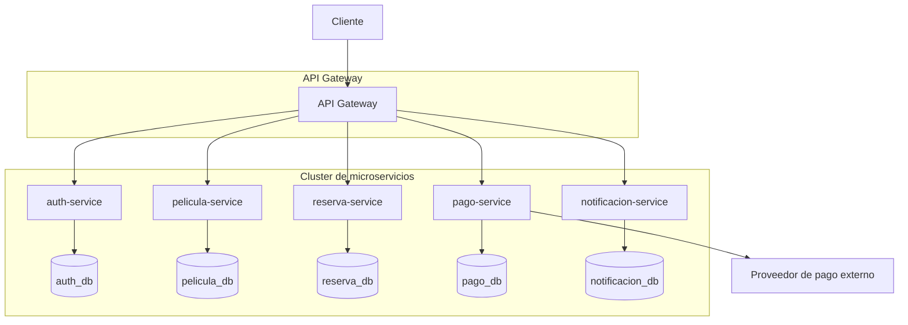

# Diagrama de Arquitectura - CineTix

Representa la comunicacion entre el cliente, el API Gateway, los microservicios
y el proveedor de pago externo. Toda la comunicacion pasa por el Gateway, no hay
comunicacion directa entre microservicios.

Notas:

- El cliente unicamente conoce al API Gateway, nunca a los microservicios directamente.
- Cada microservicio tiene su propia base de datos, ningun otro microservicio ni el
  proveedor externo accede a una base de datos que no sea la suya.
- El proveedor de pago externo esta fuera del cluster y solo se comunica con
  pago-service, nunca con la base de datos de pago-service.
- La comunicacion es unidireccional: el Gateway invoca a los microservicios, los
  microservicios no se invocan entre si.
