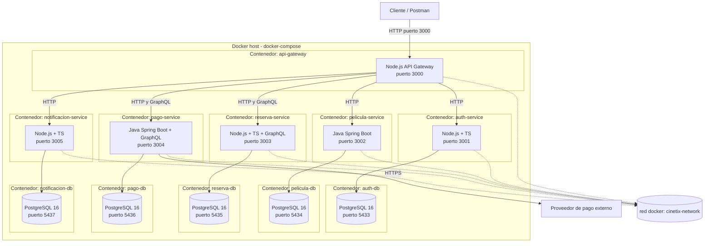

# Diagrama de Despliegue - CineTix

Representa como se despliegan los contenedores Docker mediante Docker Compose, los
puertos expuestos y las dependencias entre contenedores.

Notas:

- Todos los contenedores se levantan con un unico comando `docker compose up`.
- Cada microservicio y su base de datos corren en contenedores separados,
  comunicados dentro de la misma red interna de Docker (`cinetix-network`).
- Solo el API Gateway expone su puerto hacia el cliente externo (puerto 3000).
  Los microservicios y bases de datos son alcanzables unicamente dentro de la
  red interna de Docker.
- Cada base de datos usa un volumen propio para persistencia.
