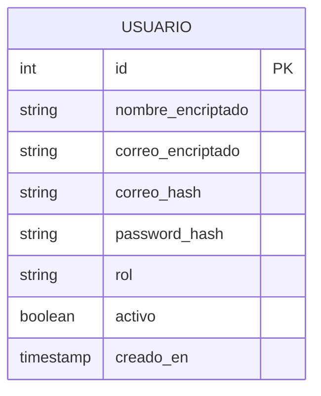
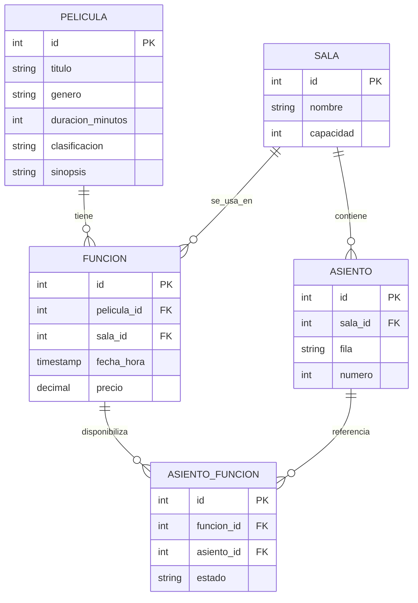
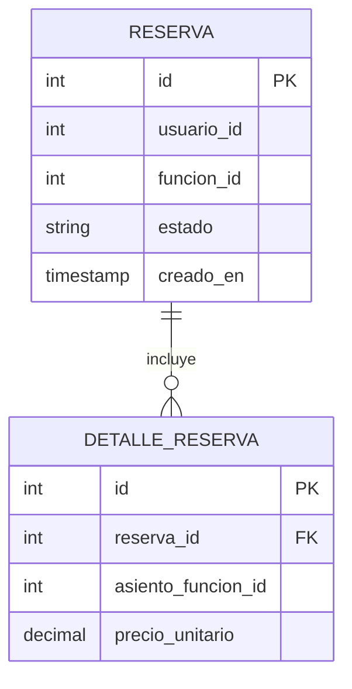
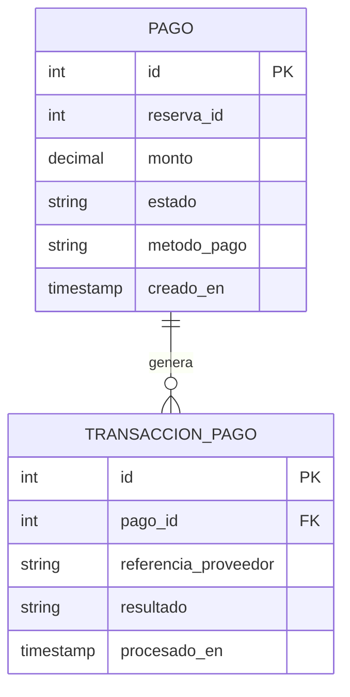
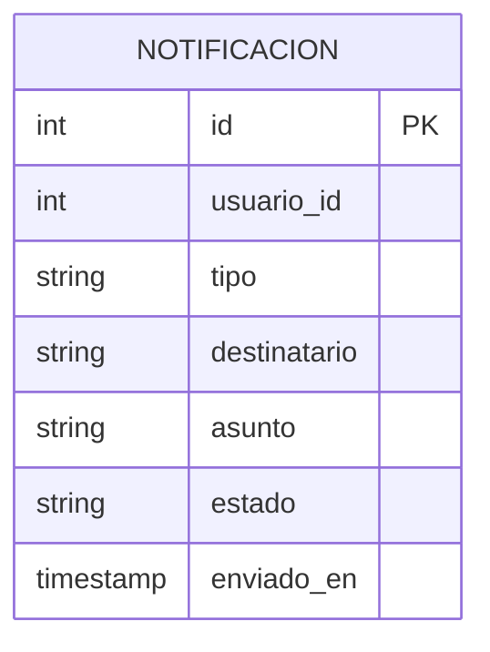

# Diagrama ER - CineTix

Cada microservicio tiene su propia base de datos independiente. A continuacion se
muestra el modelo ER de cada una.

## auth_db (auth-service, reutilizado de Practica 2)

## pelicula_db (pelicula-service)

## reserva_db (reserva-service)

Nota: `usuario_id` y `funcion_id` son referencias logicas a auth-service y a
pelicula-service respectivamente, no llaves foraneas fisicas, ya que cada
microservicio tiene su propia base de datos independiente.

## pago_db (pago-service)

Nota: `reserva_id` es una referencia logica a reserva-service.

## notificacion_db (notificacion-service)

Nota: `usuario_id` es una referencia logica a auth-service.
