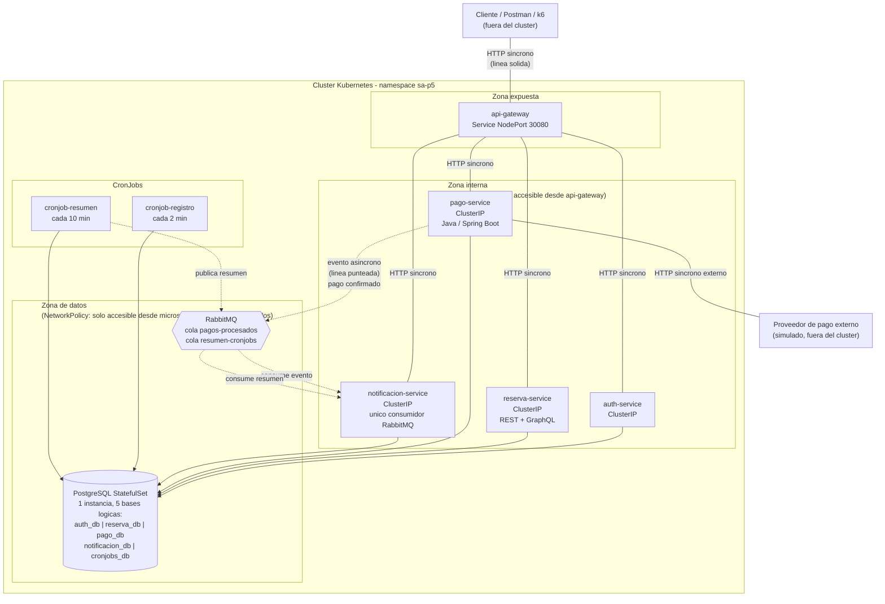

# Diagrama de Arquitectura - Practica 5

Carne: 201901844. Namespace de trabajo: `sa-p5`.

**Nota sobre el broker elegido:** se opto inicialmente por Kafka, pero durante
las pruebas en el cluster local el consumo de memoria de la JVM de Kafka
(incluso reducido a 1 sola replica) causaba reinicios por OOMKilled en un
equipo con recursos limitados. Se migro a RabbitMQ, que el enunciado permite
como alternativa valida, por ser considerablemente mas liviano (no requiere
JVM) para un entorno de desarrollo local.

## Diagrama general

## Convenciones del diagrama

- Linea solida = comunicacion sincrona (HTTP/REST/GraphQL).
- Linea punteada = comunicacion asincrona (evento RabbitMQ).
- `api-gateway` es el unico componente con Service de tipo NodePort; el resto
  usa ClusterIP o no tiene Service (segun corresponda).

## Decision: Service en vez de Ingress

El enunciado escrito (seccion E) pide un Ingress como unico punto de entrada.
En la clase de lectura de la practica, el auxiliar senalo explicitamente que,
al tratarse de un cluster local (minikube/kind/k3s), no es necesario montar
un Ingress Controller: basta con un Service para exponer el gateway, ya que
de todas formas es una red privada dentro de la maquina del estudiante. Se
opto por seguir esta indicacion verbal: `api-gateway` se expone con un
Service tipo NodePort (puerto 30080), y se documenta aqui la justificacion
para que quede trazable frente al enunciado escrito.

## Elementos internos y externos al cluster

**Internos al cluster (namespace `sa-p5`):** api-gateway, auth-service,
reserva-service, pago-service, notificacion-service, PostgreSQL
(StatefulSet), RabbitMQ, cronjob-registro, cronjob-resumen.

**Externos al cluster:** el cliente que consume la API (Postman, k6, un
navegador) y el proveedor de pago simulado que pago-service invoca via HTTP
saliente. Ninguno de los dos externos tiene acceso directo a ninguna base de
datos: el cliente solo llega hasta el gateway, y el proveedor de pago solo
habla con pago-service (nunca con `pago_db`), respetando la regla senalada
por el auxiliar sobre integridad de datos.

## Limites impuestos por las NetworkPolicies

1. `sa-p5-default-deny-ingress`: bloquea todo el trafico entrante por
   defecto en el namespace.
2. `sa-p5-allow-ingress-to-gateway`: unica excepcion de entrada sin
   restriccion de origen (es el punto de entrada del cluster).
3. `sa-p5-allow-gateway-to-microservices`: solo pods con
   `sa.usac.edu/role: gateway` pueden alcanzar pods con
   `sa.usac.edu/role: microservicio`.
4. `sa-p5-allow-services-to-postgresql`: solo pods con rol `microservicio` o
   `cronjob` pueden alcanzar el pod de PostgreSQL, puerto 5432.
5. `sa-p5-allow-services-to-rabbitmq`: solo pods con rol `microservicio` o
   `cronjob` pueden alcanzar el pod de RabbitMQ, puerto 5672.

Cualquier pod fuera de estas categorias (por ejemplo un pod de prueba lanzado
manualmente con `kubectl run`) queda bloqueado por la regla 1 y no puede
alcanzar ningun otro componente. La evidencia de este bloqueo se documenta en
`04-evidencias.md`.

## Separacion logica de datos (un StatefulSet, cinco bases de datos)

El objetivo SMART y la seccion C del enunciado piden literalmente "1 base de
datos persistente" como StatefulSet, a diferencia de la Practica 4 donde cada
microservicio tenia su propio contenedor de PostgreSQL. Para no romper el
principio senalado por el auxiliar ("ni otro microservicio deberia acceder a
la base de datos de otro"), se despliega un unico motor de PostgreSQL con
cinco bases de datos logicas independientes (`auth_db`, `reserva_db`,
`pago_db`, `notificacion_db`, `cronjobs_db`), cada una accedida
exclusivamente por su dueno. Ningun componente lee o escribe en la base de
datos logica de otro.
