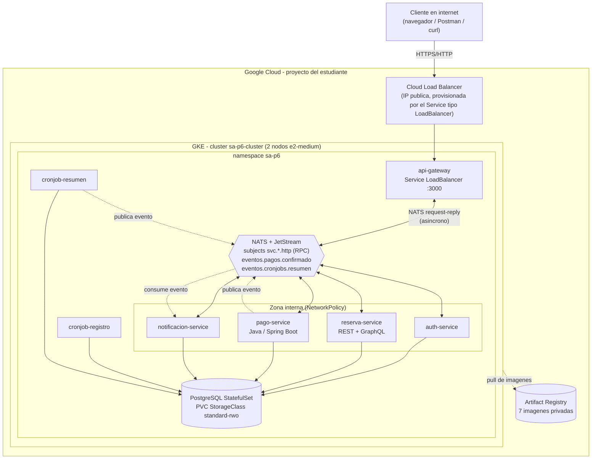

# Arquitectura en la nube - Practica 6

Carne: 201901844. Namespace de trabajo: `sa-p6`. Proveedor: Google Cloud (GKE).

## Diagrama general

## Que cambia frente al cluster local de la Practica 5

| Aspecto | Practica 5 (local) | Practica 6 (GKE) |
|---|---|---|
| Cluster | minikube/kind en la maquina del estudiante | GKE administrado, 2 nodos `e2-medium` |
| Direccion publica | No existe (NodePort en `localhost`) | IP publica real, asignada por un Cloud Load Balancer |
| Registro de imagenes | Imagenes locales (`imagePullPolicy: IfNotPresent`, sin registry) | Artifact Registry privado, `imagePullPolicy` sigue en `IfNotPresent` pero ahora **si** hace pull real |
| Almacenamiento | PVC con la StorageClass por defecto de minikube/kind (disco del host) | PVC con la StorageClass `standard-rwo` de GKE (disco persistente regional real, con SLA del proveedor) |
| Balanceo de carga | Simulado (NodePort + `kubectl port-forward` en la practica) | Cloud Load Balancer real de Google, con IP publica |
| Identidades/costos | No aplica (nada corre fuera de la maquina del estudiante) | Facturacion real por proyecto de GCP; el estudiante administra su propia cuenta de servicio/credenciales de `gcloud` |

## Correccion de comunicacion sincrona -> asincrona (heredada de P5)

La Practica 5 dejo al `api-gateway` hablando HTTP sincrono directo con cada
microservicio (via `http-proxy-middleware`), justificado en su momento
porque el enunciado de esa practica no exigia explicitamente lo contrario.
La rubrica de la Practica 6, sin embargo, **exige como requisito previo**
"Comunicacion Asincrona: debe contar con comunicacion asincrona entre
microservicios y api-gateway" para poder calificar. Ademas, el auxiliar
habia recomendado originalmente usar **NATS** como broker de mensajeria del
curso, recomendacion que no se habia seguido en P5 (se uso RabbitMQ).

Se resolvieron ambos puntos juntos, antes de tocar nada de infraestructura
de nube:

1. **Broker**: se reemplazo RabbitMQ por NATS JetStream en los dos flujos de
   eventos que ya existian (pago confirmado -> notificacion, resumen de
   cronjob -> notificacion). JetStream reproduce las mismas garantias que
   se tenian con RabbitMQ (stream con retencion, consumidor durable, ack/nak
   manual, reparto de carga por queue group entre replicas).
2. **Transporte gateway <-> microservicios**: se agrego un "bridge"
   NATS-HTTP en cada microservicio (`src/*/src/nats/httpBridge.ts` en Node,
   `NatsHttpBridge.java` en pago-service). El gateway ya no abre sockets
   HTTP hacia los pods: publica la peticion en el subject
   `svc.<servicio>.http` y espera la respuesta por el patron request-reply
   de NATS. Cada microservicio recibe esa peticion y la reenvia, por
   loopback (`127.0.0.1`), a su propio servidor HTTP interno, que **no
   cambio**: las rutas, controladores y la logica de negocio son exactamente
   los mismos que en la Practica 5.

Esto tiene una ventaja adicional para la nube: el `api-gateway` ya no
necesita saber el DNS/IP de cada microservicio (antes usaba
`AUTH_SERVICE_URL`, `RESERVA_SERVICE_URL`, etc.), y NATS reparte la carga
entre replicas usando "queue groups" sin depender de los `Service` de
Kubernetes para ese trafico. Por eso la `NetworkPolicy`
`allow-gateway-to-microservices` de la Practica 5 se volvio innecesaria y se
elimino: ahora solo hace falta una regla que permita a los roles `gateway`,
`microservicio` y `cronjob` alcanzar al pod de NATS (puerto 4222).

## Por que se mantuvo PostgreSQL dentro del cluster (no se migro a Neon)

En clase el auxiliar recomendo usar Neon DB para quienes todavia tenian su
base de datos en local. Esta plataforma, sin embargo, ya consolido las 5
bases logicas en **un unico StatefulSet de PostgreSQL dentro del cluster**
desde la Practica 5 (requisito explicito de esa practica: "1 base de datos
persistente"). Mover esa base a Neon en la Practica 6 seria dar un paso
atras frente a lo ya construido, y ademas le quitaria al despliegue la
evidencia mas directa del criterio "Configurar el almacenamiento
persistente utilizando la StorageClass que ofrece el proveedor" (2.1 de la
rubrica): el PVC de PostgreSQL usando `standard-rwo` de GKE **es** esa
evidencia. Por eso se decidio mantener PostgreSQL en el cluster.

## Registro de contenedores elegido

**Artifact Registry** (nativo de Google Cloud), porque el cluster ya esta en
GKE y el propio proveedor de nube maneja el permiso de `pull` entre
Artifact Registry y GKE sin configuracion adicional (a diferencia de usar,
por ejemplo, Docker Hub, donde el auxiliar advirtio que las politicas
"algunas veces no dejan utilizar otros registries" y ademas Docker Hub solo
permite una imagen privada gratis). Las 7 imagenes se publican **privadas**.
