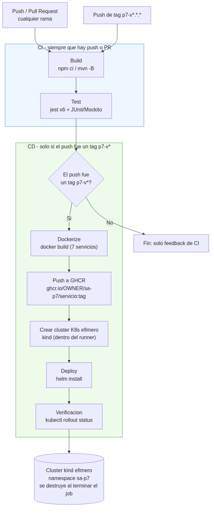

# Diagrama del pipeline - Practica 7

## Vision general (4+ fases exigidas por el enunciado)

## Las 4 fases pedidas explicitamente (seccion 3.2 del enunciado)

1. **Build**: `npm ci` + `npm run build` (TypeScript -> `dist/`) para los 4
   servicios TS, y `mvn -B test` (que en Maven incluye la fase `compile`)
   para `pago-service`. Corre en cada push/PR, en paralelo por servicio
   (matrix de GitHub Actions).
2. **Test**: `npm test` (Jest) en los 6 servicios Node y JUnit 5 + Mockito
   en `pago-service`. Todas las pruebas son unitarias, aisladas y rapidas
   (base de la piramide de pruebas vista en la clase de esta semana): no
   requieren Postgres, NATS ni Kubernetes reales.
3. **Dockerize**: `docker/build-push-action` construye las 7 imagenes con
   los mismos `Dockerfile` multi-stage de la Practica 5
   (`P5/docker/<servicio>/Dockerfile`), usando `P5/` como contexto de
   build (igual que hacia `desplegar-gke.ps1` en la Practica 6).
4. **Deploy**: se crea un cluster de Kubernetes efimero con `kind`
   (Kubernetes-in-Docker) dentro del propio runner de GitHub Actions, y
   ahi se instala el chart desde cero con `helm install` (namespace
   `sa-p7`, credenciales generadas al vuelo solo para ese cluster
   desechable). Se espera (`--wait`) a que el rollout termine antes de dar
   el job por exitoso. Al terminar el job, GitHub destruye el runner y con
   el el cluster: no queda nada corriendo ni se genera costo de nube
   (cambio de alcance indicado por el auxiliar: la practica no requiere
   nube, solo demostrar el pipeline).

## Por que el deploy solo corre en tags

La rubrica (2.4, "Versionamiento") pide que las etiquetas, ramas o
releases disparen las acciones correctamente. Aqui:

- Cualquier commit en cualquier rama, o un Pull Request, dispara **solo**
  el CI (build + test): retroalimentacion rapida sin tocar produccion.
- Solo un **tag** con el formato `p7-vX.Y.Z` (por ejemplo `p7-v1.0.0`)
  dispara adicionalmente el build/push de imagenes y el despliegue: el tag
  representa una version concreta y deliberada que se decide promover, no
  cada commit intermedio.

