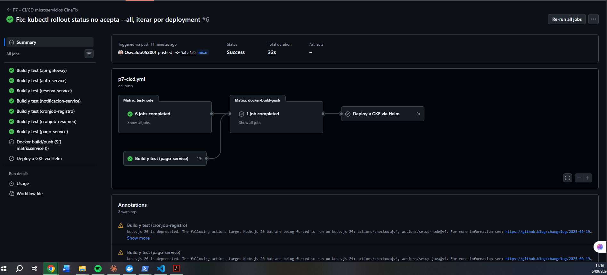
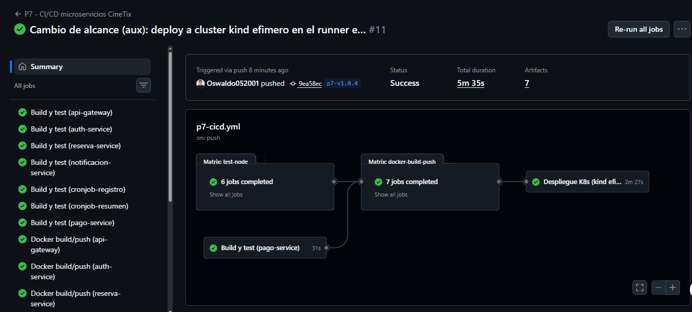
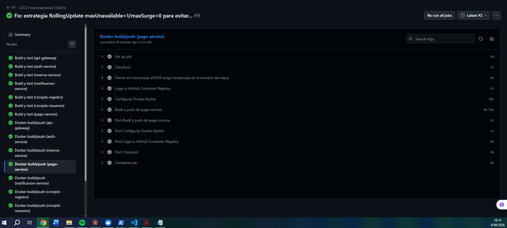
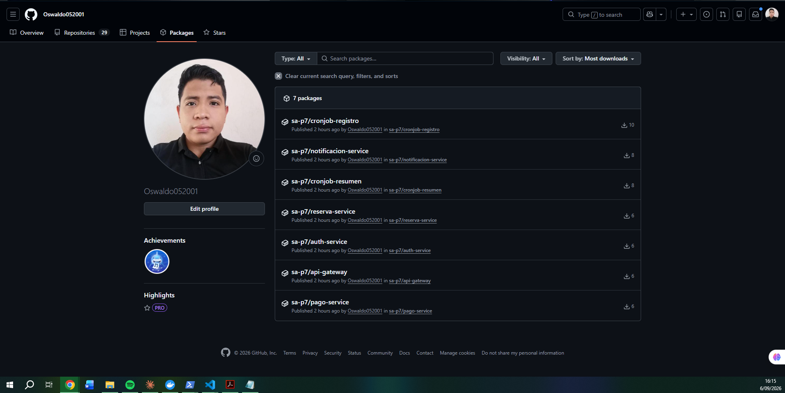

# Evidencias requeridas - Practica 7

Capturas del pipeline exitoso desde la interfaz de Actions (entregable
"Evidencia de ejecucion").

## 1. CI en un push/PR normal

- [x] Pestana **Actions** del repositorio, mostrando una corrida disparada
      por push/PR con los jobs `test-node` (los 6 servicios en verde) y
      `test-java` en verde, y los jobs de Docker/deploy **no ejecutados**
      (gris/omitidos), para evidenciar que el CD solo corre en tags.

## 2. CI + CD completo (al empujar un tag `p7-v*`)

- [x] Vista general del workflow con los 4 jobs (`test-node`, `test-java`,
      `docker-build-push`, `deploy`) en verde.

- [x] Log expandido de un job `docker-build-push` (cualquier servicio)
      mostrando el build y el push exitoso a `ghcr.io`.

- [ ] **PENDIENTE**: Log del job `deploy` mostrando la creacion del
      cluster `kind`, el `helm install` exitoso y la salida de
      `kubectl rollout status` / `kubectl get pods`. Se captura entrando
      al job "Despliegue K8s (kind efimero)" del run del tag y
      expandiendo los pasos "Crear cluster Kubernetes efimero (kind)",
      "helm install (...)" y "Verificacion post-despliegue".

## 3. Registro de contenedores

- [x] Pagina de paquetes de GitHub (`https://github.com/users/<usuario>/packages`)
      mostrando los 7 paquetes `sa-p7/<servicio>` publicados.

## 4. Cluster despues del despliegue

Nota: desde el cambio de alcance indicado por el auxiliar, el despliegue ya
no es a GKE sino a un cluster "kind" efimero creado dentro del propio job
de GitHub Actions (namespace `sa-p7`). Esta evidencia se toma del log del
paso "Verificacion post-despliegue" del job `deploy` (no hay cluster que
consultar despues, porque se destruye junto con el runner al terminar el
job) — es la MISMA captura pendiente de la seccion 2.

- [ ] **PENDIENTE** (misma captura que arriba): log del paso
      "Verificacion post-despliegue" con `kubectl get pods -n sa-p7 -o
      wide` (todos `Running`, imagenes con el tag nuevo) y el
      `kubectl rollout status` de cada deployment en `Success`.

## 5. Diagrama del pipeline

- [x] Diagrama del pipeline, ver `01-diagrama-pipeline.md` (imagen
      `img/01-diagrama-pipeline.png`).

