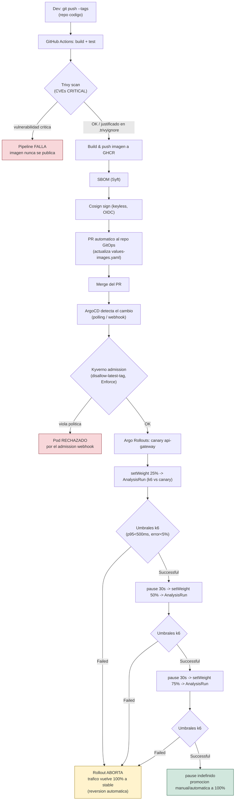

# Diagrama del flujo GitOps (criterio 1.2)

Universidad San Carlos de Guatemala, Software Avanzado, Seccion B, carne
201901844. Flujo completo desde el commit hasta el cluster, marcando los
puntos de validacion (que pueden detener el flujo) y el punto de reversion
automatica.

## Puntos de validacion (pueden detener el flujo)

1. **Trivy (CVEs CRITICAL)** - en el pipeline de CI, antes de publicar la
   imagen. Si hay una CVE CRITICAL sin justificar en `.trivyignore`, el job
   falla y la imagen nunca llega a GHCR ni al repo GitOps.
2. **Kyverno admission (`disallow-latest-tag`, Enforce)** - en el cluster,
   al momento en que Kubernetes intenta crear el Pod. Rechaza cualquier Pod
   sin tag explicita o con `:latest`, sin importar que ArgoCD ya haya
   sincronizado el manifiesto.
3. **AnalysisRun (k6 contra `/ready-check` del canary)** - durante el
   rollout progresivo. Si el 95% de las peticiones no responde en <500ms o
   la tasa de error supera 5%, el `AnalysisRun` pasa a `Failed` y Argo
   Rollouts aborta el despliegue automaticamente, devolviendo el 100% del
   trafico a la version `stable` sin que nadie tenga que intervenir.

## Punto de reversion automatica

El nodo resaltado en amarillo (`M1`) es la reversion automatica exigida por
el criterio 2.4: ocurre completamente dentro del cluster, orquestada por
Argo Rollouts, sin que ArgoCD ni el pipeline de CI tengan que hacer nada
adicional. Evidencia y cronologia detallada en
[`informe-incidente.md`](informe-incidente.md).
