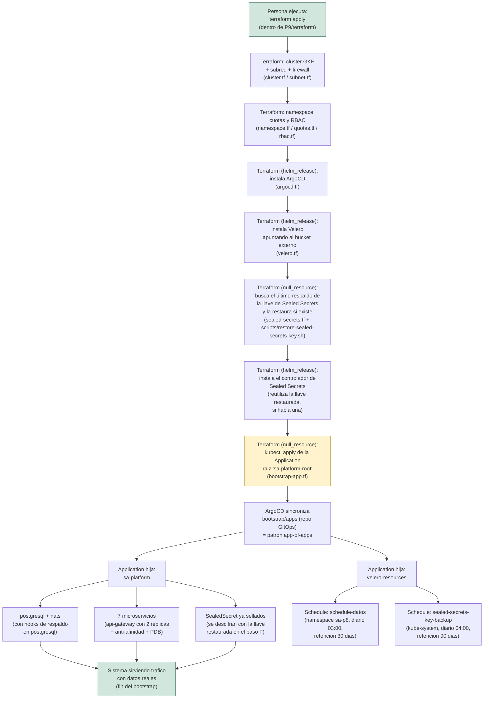

# Diagrama del bootstrap de día cero (criterio 1.3 / entregable "Diagrama del bootstrap")

Universidad San Carlos de Guatemala, Software Avanzado, Sección B, carné
201901844. Orden de reconstrucción y dependencias entre componentes, desde
`terraform apply` hasta que el sistema de negocio (sa-platform) está
sirviendo tráfico con datos reales. Distingue lo **automático** (todo,
dentro de un único comando) de lo que en Práctica 8 era manual.

## Qué es automático y qué requiere una decisión humana previa

Todo el flujo de `A` a `L` corre dentro de **un solo `terraform apply`**
(criterio 2.1, "sin pasos manuales"). El nodo resaltado en amarillo (`H`)
es el único punto donde Terraform ejecuta `kubectl` directamente (via
`local-exec`), en vez de un recurso nativo de un provider — la razón
técnica está documentada en el comentario de
[`P9/terraform/bootstrap-app.tf`](../terraform/bootstrap-app.tf): el
provider `kubernetes_manifest` de Hashicorp necesita conocer el esquema
del CRD `Application` en tiempo de `plan`, y ese CRD lo acaba de instalar
`helm_release.argocd` en el mismo `apply` — forzaría a correr `terraform
apply` dos veces, lo cual sí contaría como intervención manual.

La única decisión que sigue siendo de una persona, y a propósito NO está
automatizada, es la **promoción del canary de Argo Rollouts al 100% del
tráfico** (heredada de la Práctica 8, ver
[`P8/docs/diagrama-gitops.md`](../../P8/docs/diagrama-gitops.md)): eso es
parte del flujo de *entrega* de una nueva versión de la aplicación, no del
bootstrap de la infraestructura, y la Práctica 9 pide explícitamente
conservar ese flujo tal cual ("Conservación del flujo de la Práctica 8").
